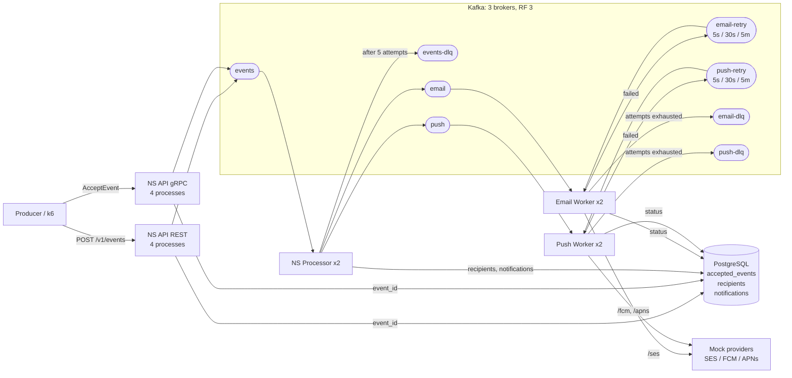
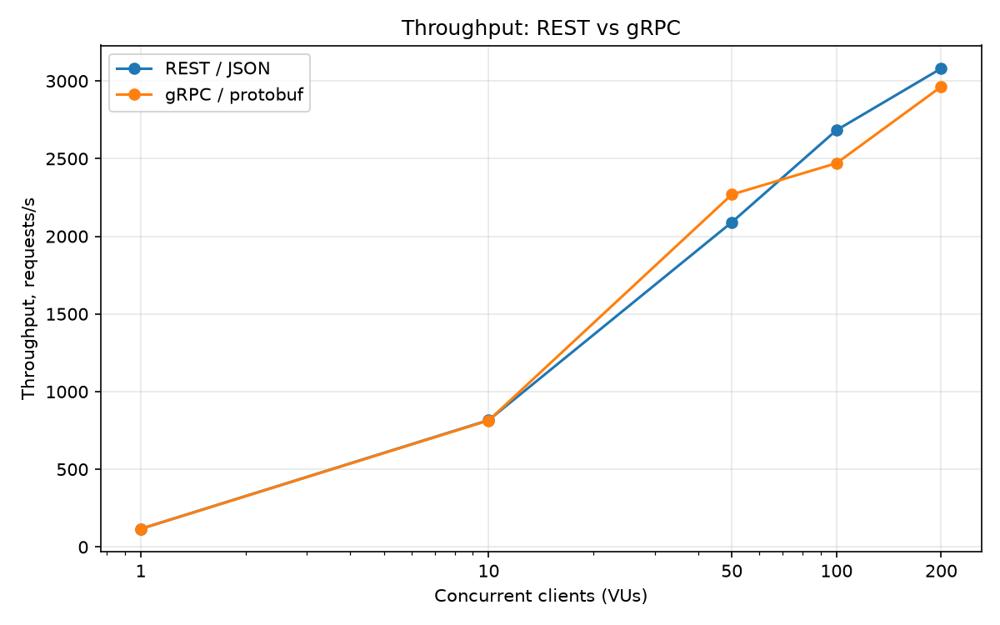
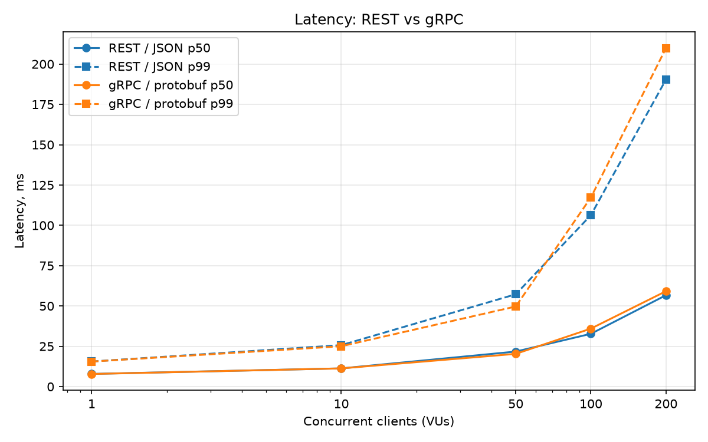
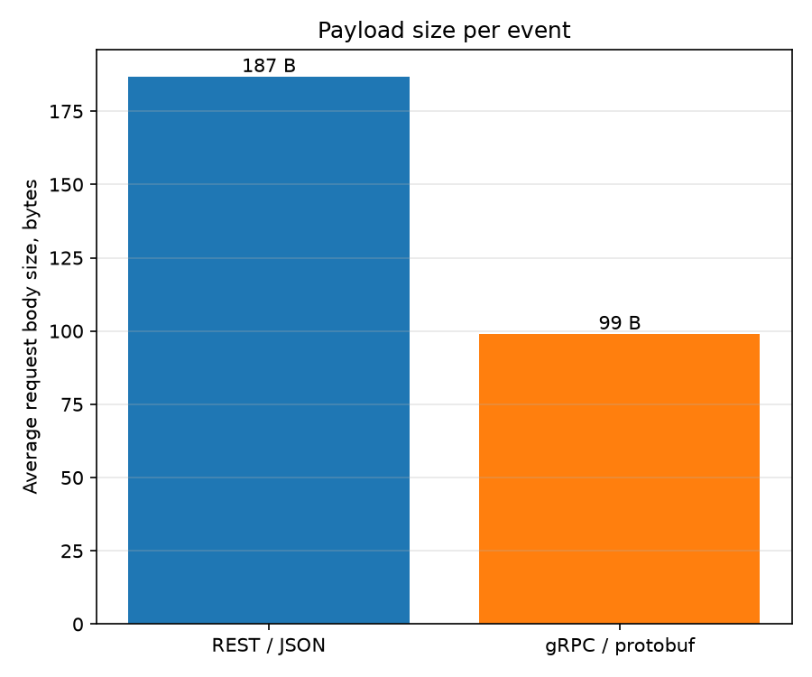

# Notification Service

Backend for High-Loaded Environments, SIS #2: implementation of the Notification Service designed in SIS #1.

The service accepts events from other services (producers), turns them into email and push notifications and delivers them to providers (SES, FCM, APNs) with retries. Delivery guarantee: at-least-once.

## Architecture

### Implemented architecture



Full SIS #1 design (with load balancer, Redis cache, rate limiter and Recipient Sync): [Excalidraw](https://excalidraw.com/#json=-2nUoLphOtkr9FqzZSVrf,3VhRnAlwYS9PysrV-5XYrQ)

### Components

| Component | Role |
|---|---|
| `ns_api` (REST and gRPC) | Accepts `POST /v1/events` / `EventService/AcceptEvent`, checks idempotency by `event_id`, writes the event to Kafka topic `events`, answers `202` |
| `ns_processor` | Reads `events`, loads the recipient, creates one notification per channel and target, saves them to PostgreSQL and writes them to topics `email` / `push` |
| `ns_worker` | One per channel (`--channel email` / `--channel push`). Sends notifications to providers, updates status, routes failures to `retry-5s`, `retry-30s`, `retry-5m` and finally to DLQ |
| `mock_providers` | Fake SES, FCM and APNs: answer `200` or `500` with a configured probability |
| `producer` | Client library for producers: timeouts, retries with exponential backoff and jitter, one `event_id` for all attempts |
| Kafka (3 brokers) | Transport: `events`, `email`, `push`, retry topics, DLQs. RF 3, `min.insync.replicas=2`, `acks=all` |
| PostgreSQL | Source of truth: accepted events, recipients, notifications and their statuses |

### Path of one event

1. Producer -> `POST /v1/events` -> NS API checks `event_id`, writes to `events`, saves `event_id`, answers `202`.
2. Processor reads the event, loads the recipient (email + iPhone), creates 2 notifications `PENDING` with deterministic `notification_id = uuid5(event_id, channel:target)`, saves them and writes to `email` and `push`.
3. Email worker -> SES `200` -> `SENT`.
4. Push worker -> APNs `500` -> `RETRYING` -> `push-retry-5s`; after 5 s -> APNs `200` -> `SENT`.
5. After the last retry topic a failed notification goes to DLQ with status `FAILED`.

### Idempotency, timeouts and retries

- **NS API:** duplicate `event_id` is not written to Kafka again. Order: Kafka first, then DB, so a failure causes a duplicate, never a loss. Timeouts: Kafka publish 2 s, DB query 1 s. If Kafka or PostgreSQL is unavailable, the API answers `503` (`UNAVAILABLE` in gRPC).
- **Producer client:** timeout per attempt 5 s (above the API worst case of 2 s + 1 s), up to 5 attempts with exponential backoff and jitter (2-4, 4-8, 8-16, 16-32 s), 90 s deadline. Retries only on network errors, `429` and `5xx`; the same `event_id` in every attempt.
- **Processor:** the same event gives the same `notification_id`, `INSERT ... ON CONFLICT DO NOTHING`. Offset is committed only after processing; after 5 failed attempts with backoff the event goes to `events-dlq`.
- **Worker:** skips notifications already `SENT`; provider timeout 3 s; failures go through `retry-5s -> retry-30s -> retry-5m -> DLQ`. Each retry topic has its own consumer, so waiting in one topic does not block others. The only unavoidable duplicate: provider accepted, worker crashed before saving `SENT`.

## Project structure

```
src/
  common/           settings, models, database pool, shared errors
  ns_api/
    rest/           FastAPI app and router
    grpc/           gRPC server and service
                    use case, Kafka publisher and repository shared by both
  ns_processor/     event consumer, use case, repositories, DLQ publisher
  ns_worker/        notification consumers, use case, provider client, templates, retry topics
  mock_providers/   fake SES / FCM / APNs
  producer/         producer client with timeouts and retries
  event_contract/   code generated from proto/
  benchmark/        payload size and chart scripts
proto/              gRPC contract
k6/                 k6 load scripts for REST and gRPC
database/           init.sql, seed.sql, drop.sql
kafka/              topic creation script
benchmark_results/  benchmark data
docs/images/        charts
compose.yml         full infrastructure
Dockerfile          one image for all services
```

## How to run

Requirements: Podman (or Docker) with compose, `uv`.

```bash
cp .env.example .env
podman build --tag=notification_service .
podman-compose up -d
```

Create tables and test recipients (1000 recipients):

```bash
podman exec -i database psql -U ns_user -d notifications < database/init.sql
podman exec -i database psql -U ns_user -d notifications < database/seed.sql
```

Send an event:

```bash
curl -i -X POST http://127.0.0.1:8000/v1/events \
  -H "Content-Type: application/json" \
  -d "{\"event_id\": \"$(uuidgen)\", \"event_type\": \"pin_liked\", \"recipient_id\": 1, \"created_at\": \"$(date -u +%Y-%m-%dT%H:%M:%SZ)\", \"payload\": {\"actor\": \"anna\", \"pin_id\": \"pin-7\"}}"
```

- Kafka UI: http://localhost:8080
- gRPC endpoint: `localhost:50051`, service `notification.v1.EventService`, contract in `proto/event_contract/events.proto`
- Tests: `uv run pytest -v`

## Benchmark: REST/JSON vs gRPC/protobuf

### Setup

- Both APIs call the same `AcceptEventUseCase`; only the transport differs.
- Each API: 1 container, 4 processes (uvicorn workers with `uvloop` for REST, `SO_REUSEPORT` processes for gRPC), Kafka producer `linger_ms=5`.
- 3 Kafka brokers, 1 PostgreSQL. One Podman VM: 7 vCPU, 16 GB RAM.
- Processors and notification workers were running during the benchmark and processed the accepted events, sharing Kafka, PostgreSQL and CPU with the API. Mock providers failed 5% of requests (`MOCK_PROVIDERS__FAILURE_RATE=0.05`).
- Load generator: k6 inside the container network (no macOS port forwarding). N virtual users, each sends the next request right after the previous response.
- Event: `pin_liked` for a random recipient out of 1000, unique `event_id` per request.
- VUs 1, 10, 50: 10 000 requests; VUs 100, 200: 100 000 requests.

Run (change `VUS` and `REQUESTS` for each level):

```bash
podman run --rm --network sis2_default -v ./k6:/scripts docker.io/grafana/k6 run -e URL=http://ns-api-rest:8000 -e VUS=50 -e REQUESTS=10000 /scripts/rest_benchmark.js
podman run --rm --network sis2_default -v ./k6:/scripts -v ./proto:/proto docker.io/grafana/k6 run -e ADDRESS=ns-api-grpc:50051 -e VUS=50 -e REQUESTS=10000 /scripts/grpc_benchmark.js
PYTHONPATH=src uv run src/benchmark/payload_size.py --output benchmark_results/payload_size.json
uv run src/benchmark/plot_results.py
```

### Throughput and latency

| VUs | REST rps | gRPC rps | REST p50 / p99, ms | gRPC p50 / p99, ms |
|---|---|---|---|---|
| 1 | 117 | 117 | 7.9 / 15.6 | 7.8 / 15.5 |
| 10 | 816 | 814 | 11.3 / 25.7 | 11.3 / 25.0 |
| 50 | 2090 | 2269 | 21.7 / 57.2 | 20.3 / 49.7 |
| 100 | 2683 | 2470 | 32.7 / 106.3 | 36.0 / 117.2 |
| 200 | 3081 | 2963 | 56.7 / 190.4 | 59.2 / 209.9 |

No failed requests in any run.





### Payload size

| Format | Avg body size | Relative |
|---|---|---|
| JSON | 187 B | 100% |
| protobuf | 99 B | 53% |

Client traffic for 100 000 requests: REST 32 MB sent, gRPC 16 MB sent.



### Analysis

- REST and gRPC have the same latency and throughput within run-to-run noise (+-10%). On short runs gRPC was a bit faster, on long runs REST was a bit faster.
- On this stand both protocols reach the same ceiling of ~3000 requests/s: the transport does not change it.
- At 1 VU latency is ~8 ms, up to 5 ms of it is `linger_ms`; under load batching pays off.
- protobuf is ~2x smaller, but at the SIS #1 peak (9000 events/s) it is ~1.7 MB/s vs ~0.9 MB/s: not a bottleneck.
- Rough `podman stats` snapshots taken during the runs (not exact averages) show no single container at 100% CPU: the API grows to ~2 cores, PostgreSQL to ~0.8, Kafka stays at ~1.7-2.3 cores for all three brokers, mostly from background replication and pipeline consumers. The ceiling looks like competition of all containers for 7 vCPU of one VM rather than one bottleneck.

### Conclusion

I keep REST/JSON for the NS API:

- gRPC gives no latency or throughput gain at any tested load, only less traffic that is not a bottleneck.
- End-to-end delivery (p99 < 5 s) is dominated by Kafka, the processor and providers (~250 ms per provider call, SIS #1 estimate), not by the input format.
- Events are stored in Kafka as JSON anyway, so the protobuf size gain is lost at the first hop.
- REST is simpler for producers: no generated code, debugging with `curl`, readable messages.

## Differences from SIS #1

- **Scale:** 3 Kafka brokers in one VM, 1 REST and 1 gRPC API, 2 processors and 2 workers per channel instead of 5 + 8 + 4 + 10 instances.их
- **No Redis:** no recipient cache and no provider rate limiter; recipients are read from PostgreSQL directly.
- **No load balancer and no Recipient Sync:** recipients come from `seed.sql`, topic `user-events` is created but not used.
- **Providers are mocked:** only `200` / `500`, no permanent errors like `UNREGISTERED`.
- **Templates** are plain strings, `locale` is not used; no daily partitioning and 30-day TTL for `notifications`.
- **Schema** is applied manually with `psql`, no migration tool.